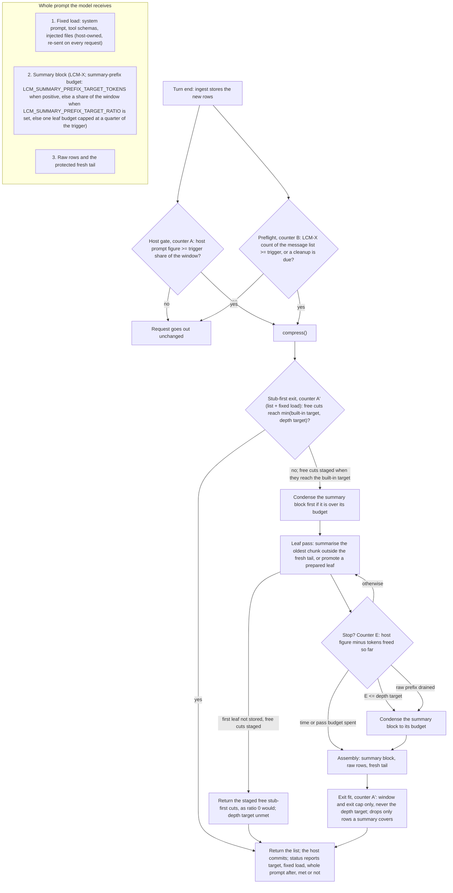

# Compaction flow and token counters

LCM-X starts a threshold sweep when prompt pressure reaches the trigger. An
optional depth target can stop the leaf passes while older raw rows are still
in the view. The summary block has its own budget, and assembly and exit fit
apply their own limits.

| Counter | What it measures | Where |
| --- | --- | --- |
| A | Host-reported prompt size, including fixed load | `should_compress()` reads the host figure |
| B | Tokens in the message list | `should_compress_preflight()` calls `count_messages_tokens()` |
| A′ | The measured list plus fixed load | `_stub_first_exit()` and survival fit use `_survival_measure()` and `_survival_host_overhead()` |
| E | Pass estimate after the net savings from each leaf | `_prepare_compression_sweep()` initializes it, `_admit_leaf_and_adopt_replay()` adjusts for a resumed prefix, and `_advance_after_leaf()` updates it after publication |

The depth check adds the conversation's observed fixed load to E when the host
has supplied no prompt figure for the current pass. Status reports the final
list measured with `_survival_measure()` plus fixed load, while the stop decision
uses the pass estimate or the stub-first check.
