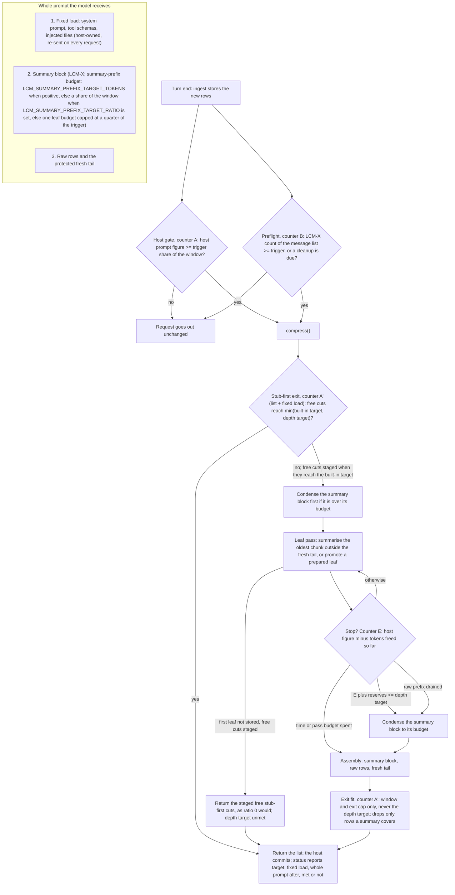

# Compaction flow and token counters

LCM-X starts a threshold sweep when prompt pressure reaches the trigger. An
optional depth target can stop the leaf passes while older raw rows are still
in the view. The summary block has its own budget, and assembly and exit fit
apply their own limits.

| Counter | What it measures | Where |
| --- | --- | --- |
| A | Host-reported prompt size, including fixed load | `should_compress()` reads the host figure |
| B | Tokens in the message list | `should_compress_preflight()` calls `count_messages_tokens()` |
| A′ | The measured list plus fixed load | `_stub_first_exit()` and survival fit use `_survival_measure()` and `_survival_host_overhead()` |
| E | Pass estimate after the net savings from leaves and, with an active depth target, condensations | `_prepare_compression_sweep()` initializes it, `_admit_leaf_and_adopt_replay()` adjusts for a resumed prefix, and publication credits the savings |

The depth check adds the proactive recall budget when recall is enabled. It
also adds the observed fixed load when the host supplied no prompt figure for
this pass. Status measures the final list, including any recall block, and adds
fixed load.

A retry can stop as soon as it adopts a committed prefix that meets the depth
target. It then returns the adopted summary and skips post-leaf condensation.

While the depth target is active, the sweep scales positive token savings using
the host prompt figure minus the booked fixed load, divided by the LCM-X count
of the input list. The scale is clamped to 1–4 and defaults to 1 when the host
figure or list count is missing. Increases use the unscaled token count.

With an active depth target and the resolved foreground defaults (60 s soft,
120 s hard), a sweep that has stored a leaf or condensed node can admit
additional calls while its estimate stays above the depth target. A call the
base budget would refuse gets a timeout of 85% of the smaller of the configured
summary timeout and the time left to the catch-up bound (the start of the pass
plus 210 s, minus the greater of the finalization reserve and 20 s), and it is
admitted only when its estimate fits that timeout. Pre-leaf condensation keeps its leaf reservation and credits the frontier
saving before the first leaf check. Each stored post-leaf condensation group
refreshes the estimate and closes catch-up as soon as it reaches the target.
Forced, overflow and recovery passes, non-default foreground settings, and
passes with the ratio unset or zero use the base admission budget.
